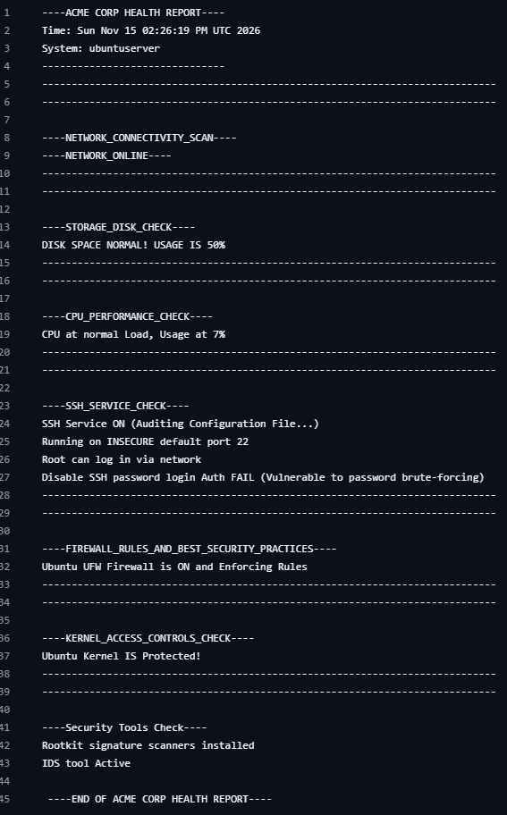
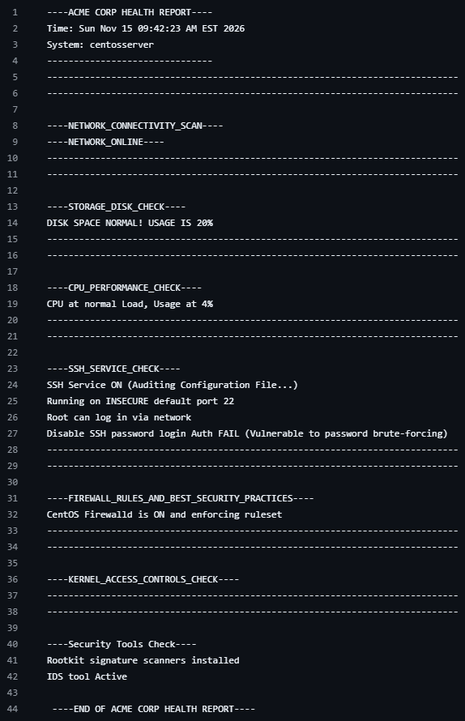

# Server Health & Security Hardening Script

A cross-platform Linux bash script (`server_hardening.sh`) built by upgrading an intentionally flawed baseline script crafted by my professor (`BadServerHealthCheck.sh`) using Linux security hardening checks and automated reporting.

* **`server_hardening.sh`** - The final script, after modifying BadServerHealthCheck.sh.
* **`BadServerHealthCheck.sh`** - The original script that server_hardening.sh derived from.
* **`Ubuntu server_health.log`** - Sample of server_hardening output on Ubuntu Machine.
* **`Centos server_health.log`** - Sample of server_hardening output on Centos Machine.

## Improvements Made to Script

* **Cross_Platform Support:** Updated commands to run cleanly across Ubuntu and Centos Distros
* **Comments:** Comments to assit in understanding the meaning and use of lines in the script
* **Automated Reports:** Added Structure to a messy report with script saves clean logs to report that is timestamped and saved into `ACME_Hardening/server_health.log` file.
* **Adjustable Thresholds:** Created Global Variables like `CPU_THRESHOLD`, `DISK_THRESHOLD`, and `SSH_PORT` at the top of the script for quick and easy adjustments.
* **Security Hardening Checks:** Added sections based on Linux Security hardening Checklist.

## How To Use tool

1. **Download Script:**

2. **Make the script executable:**
   ```bash
   chmod +x server_hardening.sh
   ```

3. **Run the script as admin:**
   ```bash
   sudo ./server_hardening.sh
   ```

4. **View the generated report:**
   ```bash
   cat ACME_Hardening/server_health.log
   ```
## Example Output

### Ubuntu Test Run


### CentOS Test Run

